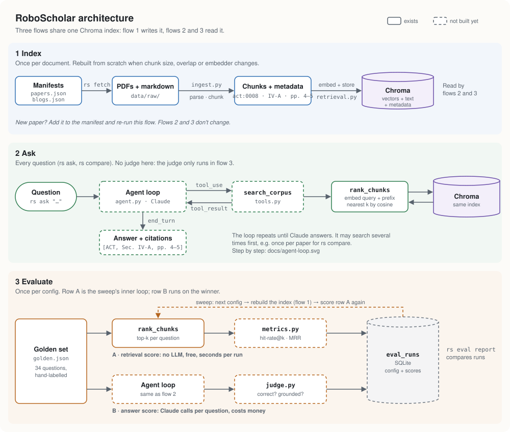
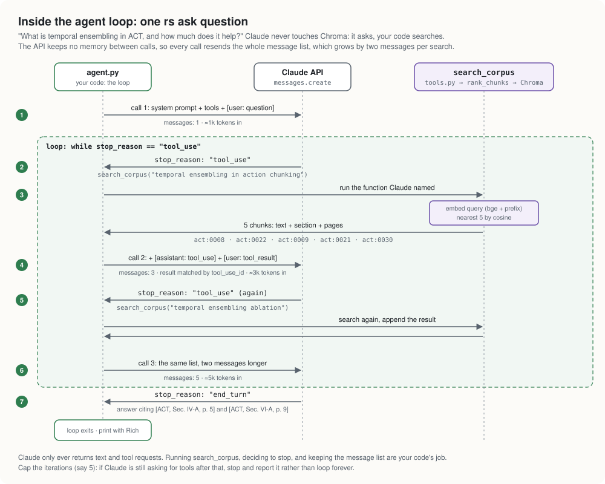

# NOTES — decisions, tradeoffs, reasoning

How RoboScholar works and why it's built this way (README.md is the pitch).
One entry per decision, newest at the bottom, except the orientation section
right below, which is meant to be read first.

---

## How it all fits together

Three flows share one Chroma index. Flow 1 writes it; flows 2 and 3 only read
it. Solid boxes exist, dashed ones don't yet.

### Flow 1: index (once per document)

`rs fetch` downloads the papers listed in `data/raw/papers.json`; blog posts
are committed as markdown. `ingest.py` splits each document into sections and
each section into chunks of whole sentences, tagged with `paper_id`, `section`
and a page range. `retrieval.py` embeds every chunk once (one dense vector per
chunk) and stores vector, text and metadata in Chroma.

A new paper goes through this flow once, on its own, and nothing already
indexed is touched. Changing chunk size, overlap or embedder reissues every
chunk ID, so the whole index has to be rebuilt (see "Chunk IDs").

### Flow 2: ask (every question)

Claude gets the question plus a `search_corpus` tool. When it calls the tool,
`rank_chunks` embeds the query with the same model (plus bge's query prefix)
and Chroma returns the k nearest chunks. They go back to Claude as a
`tool_result`, metadata included. Claude can search again or answer, and the
citations come from the chunk metadata rather than from Claude's memory of the
paper. `rs compare` is the same loop over two papers: Claude searches each
(filtered by `paper_id`) before writing the comparison. Nothing here is scored.

Claude never touches Chroma: a `tool_use` block is a request, and `agent.py`
runs the function and sends the result back. The API keeps no state, so each
call resends the whole message list, two messages longer per search (about
1k, 3k, 5k input tokens in the example above).

**Search at scale.** Chroma doesn't compare the query with every chunk: it
keeps an HNSW graph (approximate nearest neighbour), so query cost grows
roughly with log N. At this corpus size it doesn't matter either way: a brute
scan of 215 × 384 floats takes about 40 µs, and embedding the query about
12 ms. What grows with the corpus is competition for the top k. For "temporal
ensembling ablation", a π0.5 co-training chunk already ranks third among ACT's.

### Flow 3: evaluate (once per config)

| Score                          | Question it answers                                                  | How                                               | Cost                                |
| ------------------------------ | -------------------------------------------------------------------- | ------------------------------------------------- | ----------------------------------- |
| A: retrieval (hit-rate@k, MRR) | Did search find a chunk from the *labelled* section?                 | Compare retrieved chunk metadata to golden labels | Free, instant, no LLM               |
| B: answer (LLM-as-judge)       | Given what was found, was the *written answer* correct and grounded? | Claude reads generated vs. reference answer       | Agent run + judge call per question |

Cosine similarity only answers the first question. "X causes Y" and "X
prevents Y" sit close together in embedding space, so correctness needs the
judge. The two scores fail independently: retrieval can succeed while the
answer is still wrong, or retrieval can fail while the model answers correctly
from its training data. The second is a real failure (the system isn't using
the corpus), and only a groundedness check catches it.

**A config** is every setting that changes which chunks come back: chunk
size, overlap and embedder (these change the stored vectors, so each needs a
rebuilt index), plus query prefix, k and later the ranking method (dense or
hybrid), which only change the query.

**The sweep** is a grid search over configs, as you'd sweep hyperparameters
in MLflow. For each config: rebuild the index if needed, run score A over the
34 golden questions, store config plus hit-rate@k and MRR as one SQLite row.
`rs eval report` compares rows. The objective is hit-rate, not cosine
similarity: cosine ranks chunks within one config, its scale differs between
embedders, and a high similarity to the wrong chunk scores as well as one to
the right chunk. Only the golden labels know which is which. Score A is free,
so the grid is cheap; score B costs API calls, so it runs once, on the
winning config. After that, day to day is flows 1 and 2. Re-run the eval when
something could move the score: chunking, embedder, ranking, the agent's
prompt or model, or a batch of new papers.

**Questions outside the golden set** are never scored one by one. The golden
set is a test set: a config that does well on 34 hand-labelled questions is
trusted on new ones, as a model is trusted on unseen data because of its
held-out score. Of the judge's two checks, correctness needs a reference
answer, so it only runs on golden questions. Groundedness only needs the
answer and the chunks it came from, so it could run live on any question
(v0.2). Real questions worth keeping can be labelled by hand and added.

**Why not paste the paper into a long-context chat?** For one paper in one
sitting, that's a fair alternative and quicker to set up. This system pays off
as the corpus grows (embed once, query cheaply), in checkable citations, and
in persistence across sessions. Building and evaluating the infrastructure is
the point; studying with it is the useful side effect.

---

## Stack choices

| Layer                | Choice                                                            | Why / tradeoff                                                                                |
| -------------------- | ----------------------------------------------------------------- | --------------------------------------------------------------------------------------------- |
| LLM                  | Anthropic SDK direct, no LangChain/LlamaIndex                     | Frameworks hide the loop you need to be able to explain                                       |
| Vector DB            | Chroma (embedded, local)                                          | Zero infra, persists to disk; fewer prod features than Qdrant, not needed for v1              |
| Embeddings           | voyage-3-lite (API) vs. bge-small (local)                         | Decided by the eval harness — see "Embedding model choice"                                    |
| PDF parsing          | PyMuPDF first, Docling as plan B                                  | Academic PDFs are hostile; never silently degrade to a naive text dump                        |
| Search               | Dense first; BM25 + reciprocal rank fusion is the planned upgrade | Hybrid retrieval is common in practice and RRF is ~20 lines                                   |
| Interface            | Typer + Rich CLI                                                  | Ships fast; a web UI is an explicit non-goal (README)                                         |
| Storage (non-vector) | SQLite via stdlib                                                 | Eval run scores now; quiz history in v0.2                                                     |

### Anthropic SDK — the agent loop mechanics

One endpoint: `client.messages.create(model=..., tools=..., messages=...)`.
While `response.stop_reason == "tool_use"`, run each `tool_use` block and send
back a `tool_result` matched by `tool_use_id`; all results from one response
go in a single user message. Model split: `claude-sonnet-5` for the agent and
judge, `claude-haiku-4-5` for cheap tasks. Cache the stable prefix (system
prompt and tool schemas) with `cache_control`, since the loop re-sends it every
iteration. Docs:
[tool use](https://platform.claude.com/docs/en/agents-and-tools/tool-use/overview),
[structured outputs](https://platform.claude.com/docs/en/build-with-claude/structured-outputs)
(for `JudgeScore`),
[prompt caching](https://platform.claude.com/docs/en/build-with-claude/prompt-caching).

### Chroma — the retrieval mechanics

`chromadb.PersistentClient(path="data/chroma/")`, no server. `retrieval.py`
upserts into one collection, `chunks`, with `paper_id`/`section`/`page_start`/
`page_end` as metadata. `collection.query(query_embeddings=..., n_results=k,
where={...})` returns top-k with distances; `where` is the paper filter.
Embeddings are computed explicitly and passed in, because passing only
`documents` makes Chroma embed with its own default (all-MiniLM). That keeps
the embedder a config value and guarantees query and chunk vectors come from
the same model. A collection's distance function is fixed at creation and
defaults to L2. Docs: [Chroma](https://docs.trychroma.com/docs/overview/getting-started).

Open in `retrieval.py` as of 2026-11-10:

1. One collection holds every config. Upserting a config with fewer chunks
   leaves the previous config's extras searchable: ACT at 1,000 words
   overwrites `act:0000`–`act:0023` and leaves `act:0024`–`act:0033`.
2. The bge query prefix is in the `rank_chunks` docstring but never applied.
3. The embedder is hard-coded to bge-small in `index_chroma`.
4. The collection uses L2. Rankings match cosine today only because bge
   returns unit vectors, where ‖a−b‖² = 2 − 2cos θ.

Still to look up: reciprocal rank fusion
([rank-bm25](https://github.com/dorianbrown/rank_bm25) for the BM25 half);
LLM-as-judge pitfalls (position bias, verbosity bias, few-shot rubrics).

---

## Workflow

**Notebook-first, then productionise.** Extraction and chunking are written in
marimo notebooks (`notebooks/`), checked by eye, then moved into `roboscholar/`.
Chunk quality can only be judged by looking at chunks. Once ported, the package
is the source of truth.

**Data layout.** The manifests (`data/raw/papers.json`, `data/raw/blogs.json`)
define the corpus: `rs ingest` and the tests read them through
`fetch.corpus_files()`, so a PDF on disk without a manifest entry is ignored.
PDFs are fetched and checksummed by `rs fetch`, not committed; blog markdown is
committed so the corpus stays stable if a post changes upstream. Generated data
(`data/chroma/`, `*.db`) is gitignored and rebuildable with one command.

---

## Ingestion (notebooks/ingest.py, 2026-07)

**PyMuPDF blocks, not plain `get_text()`.** The golden set labels answers by
section and page, and the retrieval metrics score against those labels, so
metadata extraction is load-bearing. `page.get_text("blocks")` keeps page
numbers and lets us drop image blocks, the arXiv sidebar watermark and bare
page-number footers.

**Reading order: trust the content stream.** LaTeX two-column PDFs emit text
column by column. PyMuPDF's `sort=True` sorts by y-coordinate, which
*interleaves* columns, so it's deliberately off. Verified by eye on all five
papers.

**Headings: ToC first, font heuristic as fallback.** 4 of 5 papers ship PDF
bookmarks (`doc.get_toc()`): exact titles with page numbers. Fallback (used by
world-models): a short (<80 chars) bold line in a recurring (≥3 lines) font
size larger than body text, with font-size rank giving the level. If both
fail, everything lands in one "Front matter" section, and Docling is plan B.
`split_sections` returns an `unmatched` list per document: it should be empty,
and it's the first thing to check when adding a paper.

**Heading↔block matching is a normalized character-stream prefix match**
(`consume_key`), not string equality. Every complication was found empirically:

| Problem                                      | Example                                    | Fix                                                             |
| -------------------------------------------- | ------------------------------------------ | --------------------------------------------------------------- |
| Small caps extract with spaces               | `"I NTRODUCTION"`                          | normalize to `[a-z0-9]` only                                    |
| ToC and page number headings differently     | ToC `IV-A …` vs page `A. …`                | strip leading numbering from both sides                         |
| Heading merged with first paragraph          | `"IV. ACTION CHUNKING … As we will see"`   | prefix-match, keep remainder as body text                       |
| Heading split across two blocks              | `"III. ALOHA: A LOW-COST…"` + next block   | pending-continuation state                                      |
| Equation fragment impersonating a heading    | `"×K"` normalizing to `"k"`                | partial match requires ≥8 normalized chars                      |
| References missing from ToC                  | ACT bibliography polluting Sec. VII        | any `References`/`Bibliography` block forces a section boundary |
| Non-ASCII symbol in heading silently dropped | `"π0 Model"` → emitted as `"The 0 Model"`  | check the emitted label, not the source heading (pi-0/pi-0.5)   |

**What's dropped.** Figure/table caption blocks (pattern `Fig./Figure/Table +
number + [.:]`; the punctuation separates a caption from body text saying
"Figure 3 shows…", which is kept), and References/Bibliography
(`DROP_SECTIONS` in `ingest.py`), which are retrieval noise. Appendices stay:
they hold hyperparameters and task details. Title, authors and abstract stay
together in Front matter.

**Chunking: sentence-accumulation within sections.** Whole sentences up to
`n_words`, never crossing a section boundary, so no chunk holds a broken
statement or mixes topics, and every chunk's `section` label is exact (the hit
rule relies on this). Garbled-equation "sentences" are hard-split at
`n_words`; chunks under 25 words are dropped. The next chunk is seeded with
the previous chunk's trailing sentences up to `overlap_words` (default 50,
about 10% of 500). Both numbers are for the sweep to settle.

**Word-based sizing, not token-based.** Words keep the chunker
dependency-free, but the embedder's token limit is the real constraint: text
past it is silently dropped from the embedding. Measured on this corpus
(2026-11): about 1.45 tokens per word with the bge tokenizer, so bge-small's
512 tokens hold roughly 350 words and all-MiniLM's 256 roughly 175.

**Blogs: same chunker, markdown sectioning.** HTML→markdown via trafilatura
(it strips nav/footer boilerplate; html2text and markdownify keep it). h1/h2
both map to level 1, since a blog's single h1 is its title. No pages, so
`page_start`/`page_end` = 0. Settled empirically (2026-09) by dumping real
emitted labels:

- Content between the h1 and the first h2 opens a section named by the h1
  title. It isn't dropped and doesn't attach forward to the next h2.
- h3s are their own sections with compound `Parent › Child` labels. Without
  this, GAIA-3's five h3s collapse into one section.
- PDF sections store the ToC-qualified form too (`VI Ablations › VI-A Action
  Chunking and Temporal Ensembling`). ACT has `IV-A Action Chunking and
  Temporal Ensemble` (the method) and `VI-A Action Chunking and Temporal
  Ensembling` (the ablation); qualifying by parent keeps them distinct.

**Chunk IDs: `{doc_id}:{index:04d}`** (e.g. `act:0012`), where `doc_id` is the
file stem. Re-ingesting the same config overwrites rather than duplicates. IDs
are NOT stable across chunk-parameter changes, and overwriting isn't enough
when a config produces fewer chunks: the leftovers stay. So results are only
comparable within one config (the runner stores the config with the scores),
and the index must be rebuilt, not upserted into, when the config changes.

**Notebook → package (roboscholar/ingest.py).** Same pipeline plus TypedDicts,
a *computed* body font size for the heading fallback (the notebook's
hard-coded 12.0 would miss headings in a 10pt paper), and `ingest_file`
dispatching by suffix. Test-fixture lesson: the chunker's first tests passed
spuriously because the synthetic sentences were all lowercase (the sentence
regex needs a capital after the full stop) and identical (so equality checks
compared equal strings). Fixtures must be *distinct and realistic*.

---

## Embedding model choice (decided by evals)

| Model             | Where      | Cost                                     | Input limit               | Notes                    |
| ----------------- | ---------- | ---------------------------------------- | ------------------------- | ------------------------ |
| voyage-3-lite     | API        | ~free at this corpus size (token-priced) | 32k tok                   | needs network + key      |
| bge-small-en-v1.5 | local (M1) | free                                     | 512 tok (~350 words here) | the real local candidate |
| all-MiniLM-L6-v2  | local      | free                                     | **256 tok (~175 words)**  | truncates silently       |

Process: fixed golden set, small full grid, every run stored in SQLite,
decided on hit-rate@k then MRR, with cost, offline use and latency in the run
notes.

**Truncation measured (2026-11), and it changes the grid.** Chunks over
bge-small's 512 tokens across the 8 labelled documents: 2 of 386 at 200 words,
25 of 261 at 350, 77 of 215 at 500 (longest 1,212). The originally planned
500 vs 1,000 words would mostly measure truncation. Proposed instead: 200 and
350 words × 0/10/20% overlap × bge-small and voyage-3-lite (12 runs), plus the
bge query prefix on and off, with MiniLM dropped. Not yet decided.

---

## Golden set structure

One `golden.json`: 34 hand-written entries across the 8 documents (ACT 10,
GAIA-3 8, Diffusion Policy 3, π0 3, π0.5 3, GAIA-2 3, world models 2, GAIA-1
2). `source_paper` scopes each entry, so metrics can slice per document or
papers vs. blogs. Blogs have no pages and match on section only. Papers and
blogs overlap on world models (DreamerV3 vs. the GAIA posts), which gives
natural hard negatives.

---

## Reading queue — candidate papers, not in the corpus

Found 2026-09. The first three PDFs sit in `data/raw/papers/` without manifest
entries, so ingest and the eval ignore them:

- LeCun, "A Path Towards Autonomous Machine Intelligence" (v0.9.2, 2022). Two
  unmatched headings ("A Model Architecture for Autonomous Intelligence" p7,
  "Designing the Configurator" p38) file their content under the preceding
  section. Fix before writing golden entries for it.
- Apple, "The Illusion of Thinking"
- "LeWorldModel" (arXiv 2603.19312)
- Rohit Bandaru, "JEPA Deep Dive" (blog post)

Adding one: manifest entry → `rs fetch` → `rs ingest` (check `unmatched` is
empty) → read it properly before writing questions. Every golden entry comes
from actually reading the paper. An unlabelled paper still tests something: it
adds distractors, so re-running the eval shows how retrieval degrades as the
corpus grows.

---

## Retrieval metrics — how they work, how to read them

A retrieved chunk counts as **correct** when its `paper_id` matches the label
and its section matches `source_sections` **or** its page range overlaps
`source_pages` (blogs: section only).

**OR, not AND — decided 2026-09.** Page ranges are reliable; section names
come from ToC matching, which can fail. OR gives each axis a fallback; AND
turns every labelling slip into a silent zero that looks like a worse config.

**Reopened 2026-11-10: OR is lenient.** At 500 words, a question has on
average 1.68 correct chunks under section match, 1.59 under section AND page,
and 3.85 under OR. The extras are neighbouring sections sharing a page. For
act-010 (the CVAE ablation, Sec. VI-B, pages 9–10), OR also accepts V-C, VI-A,
VI-C and the conclusion: 7 of ACT's 34 chunks where section match accepts 1.
A config that ranks the wrong section first still scores a hit, so configs
bunch near the ceiling. Meanwhile the failure OR guarded against, a label that
doesn't match what ingest emits, is now caught by `tests/test_golden_labels.py`.
Proposed: decide the sweep on section match, report OR alongside. Not yet
decided.

**Validate labels before embedding anything.** `tests/test_golden_labels.py`
asserts every `source_sections` value appears in emitted chunk metadata, with
near-miss suggestions. It should also gate `eval run`: section names can drift
if the heading logic changes, and a gate turns "quietly lower scores" into
"the run refuses to start".

**hit-rate@k**: the fraction of questions where at least one of the top-k
chunks is correct. The one that matters most for RAG: the agent gets all k
chunks, so what counts is whether the answer is in there at all. **MRR**: mean
of 1/rank of the first correct chunk (0 if absent). Rewards ranking, and
shows improvements once hit-rate@k saturates.

**Picking a config.** Primary: hit-rate@k at the k `search_corpus` will
actually use. Tiebreaker: MRR, then cost/latency/offline notes. With 34
questions each is worth about 3 points of hit-rate, so a few percent is noise:
prefer configs that win across slices (per paper, papers vs. blogs), and
eyeball the failures, since one mislabelled entry moves a comparison more than
most real effects.

---

## v0.2: quiz, and how to evaluate generated questions

Quiz moved to v0.2 on 2026-11-10. Open problem, raised by a friend: "how do
you evaluate the model's ability to generate good quiz questions for new
text?" Both current scores check fixed golden questions; a generated question
has no reference. Failure modes: ungrounded (doesn't trace back to the
retrieved chunk), trivial (restates a sentence verbatim), wrong difficulty
label. Two directions (judge.py is Stan's, so this is a design note only): a
second judge prompt scoring a question against its source chunk for
groundedness and non-triviality, and a thumbs-up/down logged when a quiz is
actually taken.

---

## Ideas — parked, not built

Parked until retrieval.py and the eval harness are done (CLAUDE.md: no new
features after Day 10).

**Glossary: dropped 2026-09-14.** Marking terms while reading, then resolving
them into cited definitions, made a second place to write things down and a
term database nobody would reread. Highlight-to-ask serves the need in the
moment. The unwired code was deleted 2026-11-07.

**Socratic tutor with a reader profile (raised 2026-11-10).** Stan's framing
of the longer-term goal: a Socratic learning tool for papers and technical
posts that gets more useful as the corpus grows and adapts to the reader's
strengths, gaps and interests. Quiz (v0.2) is the first piece, since wrong
answers logged per concept are the raw material for a profile. A Textual front
end fits here (interactive quiz, a reader view showing the cited page or
figure). None of it is v0.1, which is the engine plus the evals that make
claims about it credible.

**Concept visualisation / simulation.** Floated 2026-09: show how a concept
like temporal ensembling works instead of describing it. One data point: the
π0.5 policy-factorisation walkthrough, an Artifact with terms that highlight
per step and a hover-synced symbol glossary, built on demand for one question
and judged exactly the right shape. Still open: numeric simulation of the
method or illustrative animation, which are very different scopes.

**Highlight-to-ask.** Floated 2026-09: highlight a passage while reading and
ask about it in place. Closest precedent: [Clicky](https://www.heyclicky.com/)
(hotkey → screenshot → vision model → answer), which works in any app and so
sidesteps PDFs having no DOM. Minimum build: hotkey, screenshot, one
vision-capable `messages.create` call. The RoboScholar part is grounding:
knowing which corpus document is on screen, so the answer cites a retrieved
chunk. Second data point: wanting "representation collapse" in LeWorldModel
explained in the context of its sentence, which a screenshot captures for
free.
